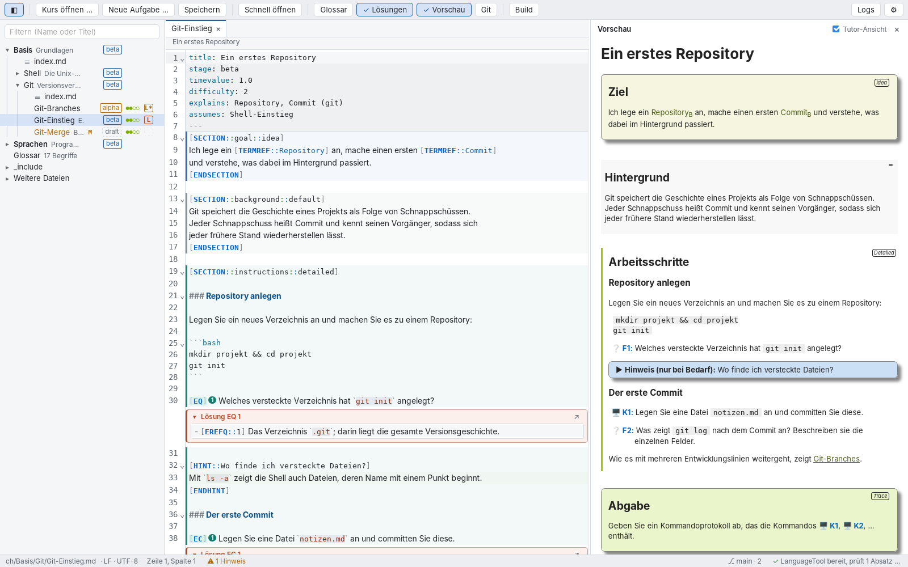
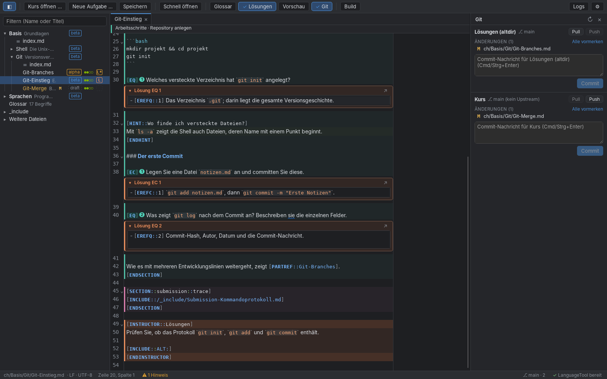

# ProPra Editor

A lean desktop editor (macOS, Windows) for writing the German task files of the
[propra-inf](https://github.com/fubinf/propra-inf) course, which is built with
[sedrila](https://github.com/fubinf/sedrila). It knows sedrila's file format, checks German
grammar and spelling offline, shows the solutions from altdir next to the tasks, previews
pages, runs sedrila builds and handles git for the course and its altdir submodule.

*Screenshots show the editor's test course (`test-fixtures/course`), not real course content.*

## Features

- **Course structure:** the file tree follows `sedrila.yaml` (chapters, taskgroups, tasks)
  with stage, difficulty, solution and git status per task. Quick open (Cmd/Strg+P) finds
  parts by name or title. New tasks are created from the course template, optionally with
  the matching altdir file.
- **Writing:** ProPra highlighting for top matter, macros and sections; prose in a
  proportional font (markup and code stay monospace); wrapping at 100 columns (adjustable,
  or at the window edge, or off); a header that shows the current section while scrolling.
- **Grammar and spelling:** a bundled LanguageTool (German, English) checks the prose
  offline. Macros, code and top matter are masked out. Words can be added to a personal
  dictionary, rules switched off.
- **Structural checks:** unknown macros, wrong arguments, unclosed blocks, invalid top matter,
  unknown parts and glossary terms, missing include files, broken `[EREFx]` references.
  Quick fixes with Cmd/Strg+. (for example „Begriff im Glossar anlegen“).
- **Glossary:** a side panel with all terms, editing in place, and „Wo verwendet?“.
- **Solutions (altdir):** each `[EC]`/`[EQ]`/`[ER]` shows its solution from altdir below
  it, editable in place. When numbering shifts, the editor offers to renumber the
  `[EREFx]` markers in both files in one undoable step.
- **Preview:** an approximation of sedrila's output with the course's own stylesheet,
  scrolled along with the editor; links to parts and terms are clickable.
- **sedrila build:** Cmd/Strg+B runs the build from the course folder; errors and warnings
  appear in a list and in the editor, located at the offending macro.
- **Git:** status, diff against the last commit, stage, commit, pull and push for the course
  repo and the altdir submodule. Committing altdir first and then the course takes the new
  submodule state along.
- **Safe with files:** atomic saves that keep line endings, BOM and the final newline;
  changes made by other programs (git, PyCharm) are reloaded, or, if you have unsaved edits,
  you choose which version to keep.
- **Interface in German or English** (⚙ „Sprache der Oberfläche“), light and dark mode
  following the system.

## Install

1. Download the build for your platform from the latest CI run on GitHub Actions: the
   artifact `propra-editor-macos-latest` contains the `.dmg`, `propra-editor-windows-latest`
   the setup `.exe`. Or build it yourself (see `CLAUDE.md`).
2. The builds are unsigned. macOS: right-click the app, „Öffnen“, then confirm. Windows:
   SmartScreen „Weitere Informationen“, then „Trotzdem ausführen“.
3. On first start, choose the course folder (the one containing `sedrila.yaml`).

Nothing else is needed for editing and grammar checking: Java and LanguageTool come with
the app. For builds and git, sedrila and git must be installed (see below).

## Settings (⚙)

- **Fonts and wrapping:** monospace font, prose font (or monospace everywhere), font size,
  wrap column.
- **Grammar:** switch LanguageTool off, disable or enable individual rules.
- **sedrila command:** default `sedrila author build --include-stage draft {outdir}`. It runs
  in the course folder through your shell, so a venv, `uv run sedrila …` or the `SEDRILA_*`
  variables from your shell configuration work as in a terminal. „sedrila testen“ checks
  the command.
- **git program:** empty uses `git` from the PATH.
- **Interface language:** German or English.

## Troubleshooting

„Logs“ in the toolbar, or a click on the LanguageTool status in the status bar, shows the
app and LanguageTool logs. „Alles kopieren“ copies both, ready to paste into a bug report.
The viewer can also restart LanguageTool and open the log folder.

## Shortcuts

| Shortcut | Action |
| --- | --- |
| Cmd/Strg+P | Quick open |
| Cmd/Strg+S | Save |
| Cmd/Strg+W | Close tab |
| Cmd/Strg+N | New task |
| Strg+Tab | Next tab |
| Cmd/Strg+F | Find and replace |
| Cmd/Strg+Shift+E | Show/hide the file tree (also ◧ at the left of the toolbar) |
| Cmd/Strg+. | Quick fix at the cursor |
| Cmd/Strg+Shift+M | Show/hide the problem list (drag its top edge to resize) |
| F8 | Next problem |
| F12 / Cmd/Strg+click | Go to definition (part, glossary term, included file) |
| Cmd/Strg+Shift+L | Show/hide solutions from altdir |
| Cmd/Strg+Alt+L | Switch between task and solution file (also: click „L“ in the tree, or ↗ on a solution) |
| Cmd/Strg+Shift+V | Show/hide the preview (double-click in the preview jumps to the source) |
| Cmd/Strg+B | Build the course with sedrila |
| Cmd/Strg+Shift+G | Git panel (stage, commit, pull, push) |
| Cmd/Strg+Shift+D | Changes of the current file against the last commit |
| Cmd+Alt+[ / ] (macOS), Strg+Shift+[ / ] (Windows) | Fold / unfold block |

## Development

Tauri 2 (Rust) with a TypeScript frontend on CodeMirror 6. Commands, layout and conventions
are in `CLAUDE.md`; the original plan is `docs/PLAN.md`, and design decisions and findings
are logged in `docs/decisions.md`. CI builds and tests on macOS and Windows for every push.
